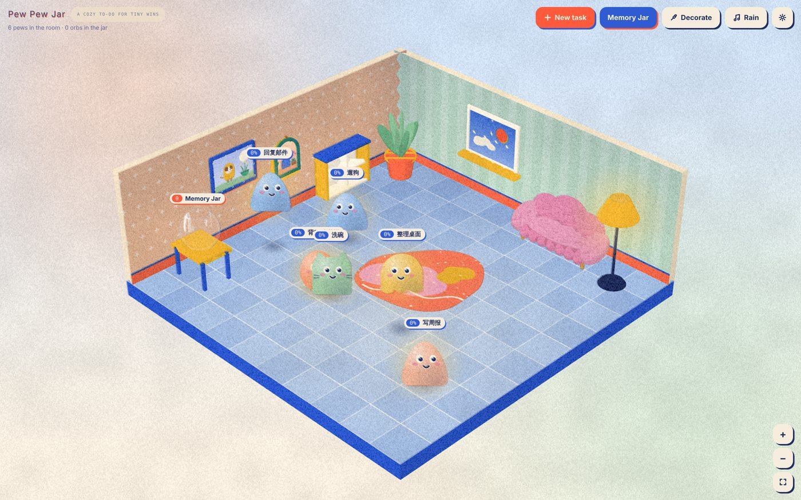
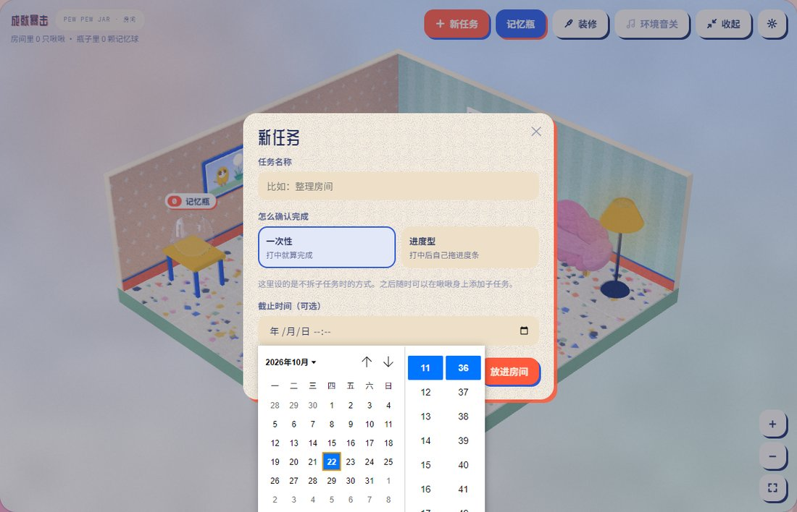
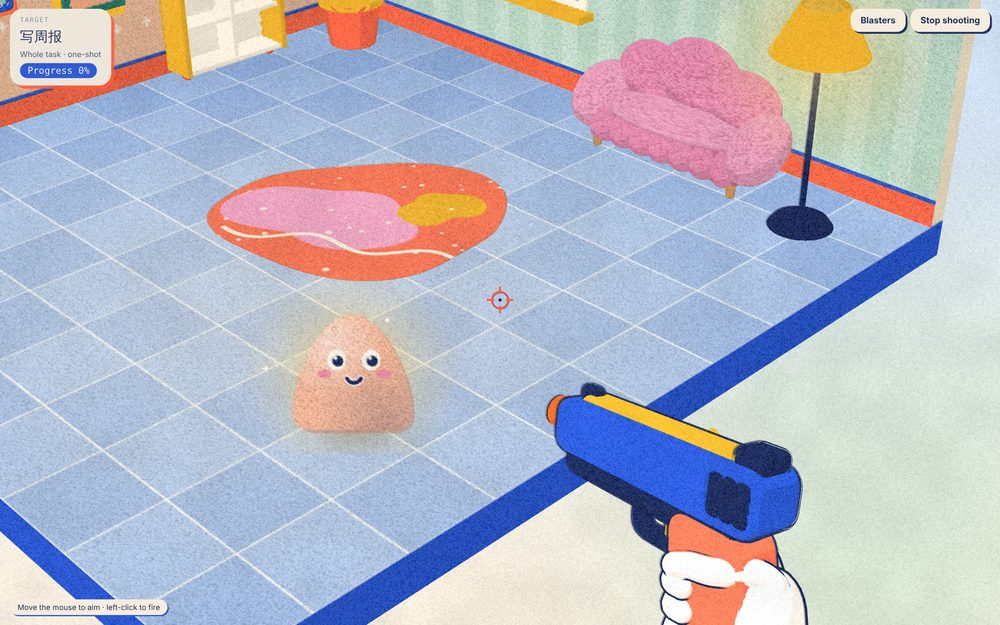
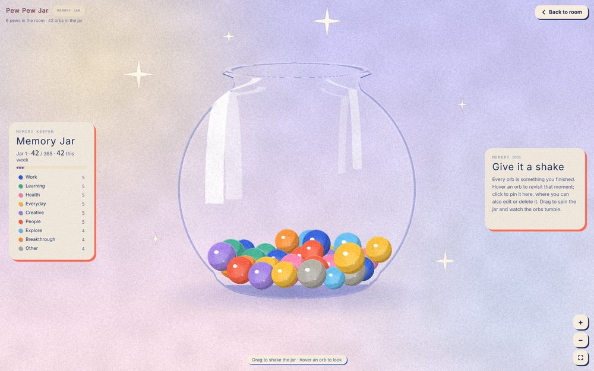
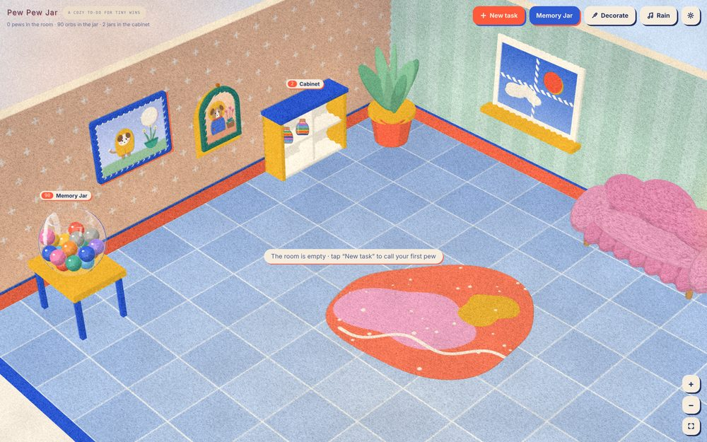
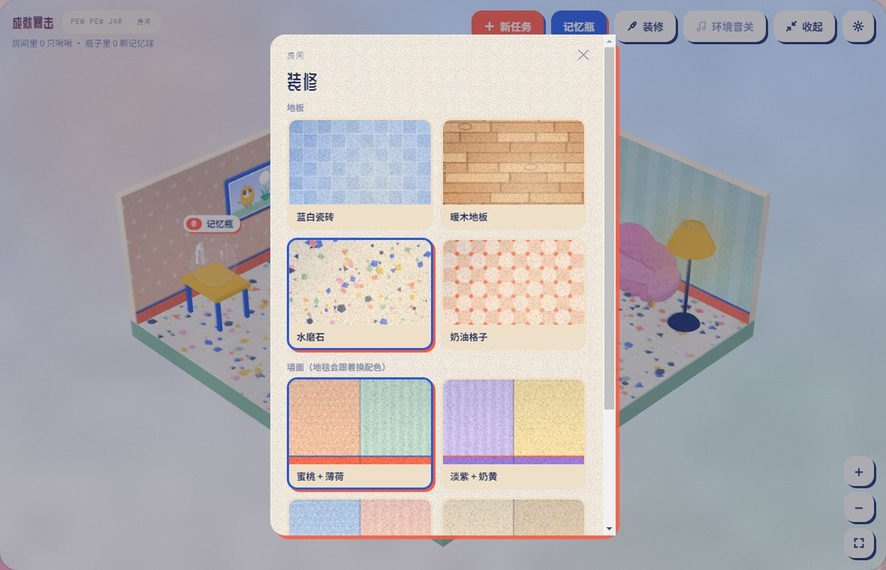
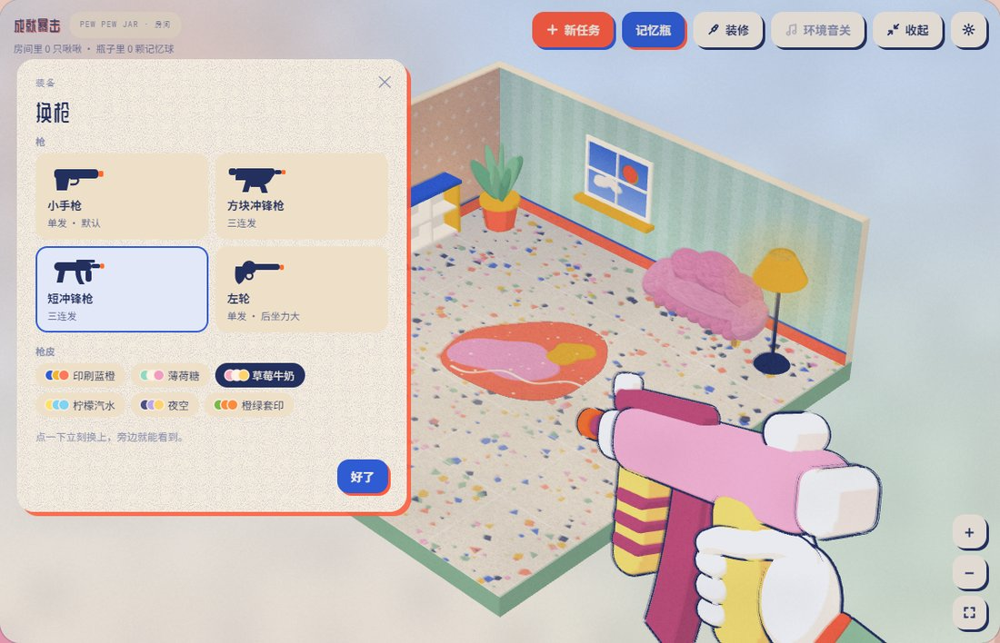
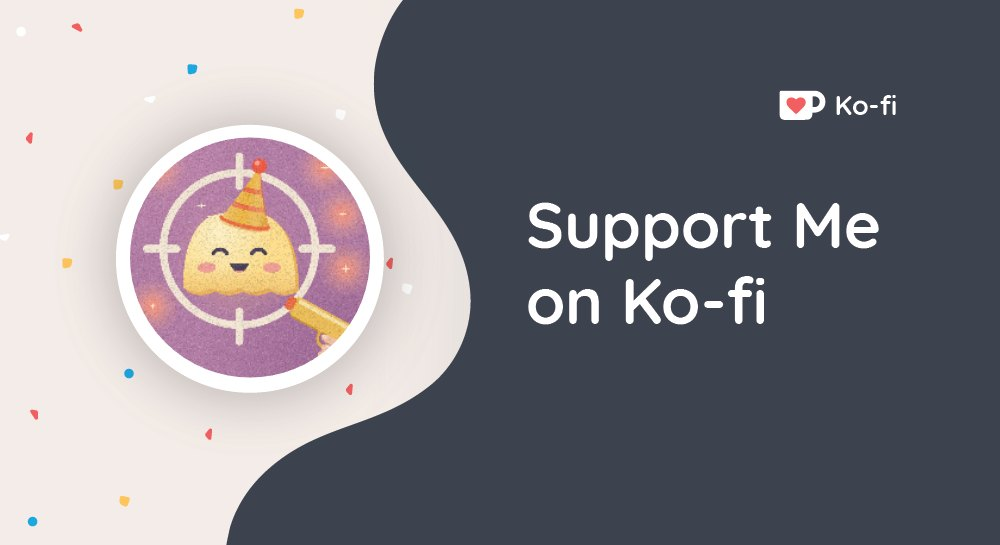
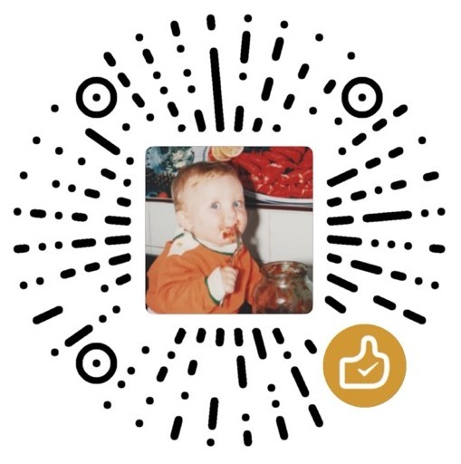

<h1 align="center">Pew Pew Jar · 成就暴击 🎯</h1>

<b>A cozy to-do for tiny wins.</b> · 把待办变成房间里的小事

  <a href="https://beiabei.itch.io/pew-pew-jar">▶ Play on itch.io</a> ·
  <a href="https://pewpewjar.netlify.app">🌐 Website</a> ·
  <a href="https://ko-fi.com/yilinding">☕ Support on Ko-fi</a>

Your tasks become little *Pew Pews* wandering a riso-printed room. Confirm progress with a toy blaster; finished things turn into memory orbs that drop into a glass jar.

把待办变成房间里的 Pew Pew，用玩具枪确认进度，做完的事变成记忆球，掉进玻璃瓶里。

## ✨ What You'll Find / 主要功能

- **Task Management / 任务管理** — Organize your everyday tasks and keep track of progress. · 整理日常待办事项，记录任务进展。
- **Playful Feedback / 趣味反馈** — Make completing tasks a little more fun and rewarding. · 让完成任务的过程更有趣、更有成就感。
- **Collect Your Achievements / 成就收集** — Save little memories of your progress and revisit them later. · 收藏自己的进步与回忆，随时回顾。
- **Decorate Your Room / 装饰房间** — Wallpaper, flooring and furniture all come in a few swappable styles (furniture stays in its place). · 墙纸、地板和家具款式都可以随时换（家具摆放的位置是固定的）。
- **Your Own Little Space / 专属小空间** — An interactive 3D room as part of your productivity routine. · 在互动式 3D 场景中体验不一样的任务管理方式。

## 🎮 How It Works / 核心玩法很简单

From summoning a Pew Pew to it becoming a memory orb in the cabinet — here's the whole flow in four steps.
从召唤一个 Pew Pew，到它变成记忆球收进柜子——整个过程就这四步。

<table>
<tr>
<td width="50%" align="center"> <b>1 · Summon a Pew Pew</b> · 召唤一个 Pew Pew Create a task and it appears — deadline optional, subtasks can be added later. 新建任务就会出现一只，截止时间随意，之后还能加子任务。</td>
<td width="50%" align="center"> <b>2 · Confirm progress with a toy blaster</b> · 用玩具枪确认进度 Gun skins and models are swappable — a one-shot task is done in a single hit. 枪皮和枪型都能换，一次性任务一枪就算完成。</td>
</tr>
<tr>
<td width="50%" align="center"> <b>3 · Becomes a memory orb</b> · 变成一颗记忆球 Pick a category and mood, then it drops into your jar. 可以选分类和当下的心情，再收进记忆瓶。</td>
<td width="50%" align="center"> <b>4 · A full jar goes in the cabinet</b> · 瓶子满了收进储物柜 Every 365 orbs seals into a jar on the shelf. 每满 365 颗封一瓶，摆上柜子。</td>
</tr>
</table>

## 🎨 Make It Your Own / 可以这样自定义

<table>
<tr>
<td width="50%" align="center"> Swap the wallpaper, flooring and furniture styles anytime. 墙纸、地板和家具款式都可以随时换。</td>
<td width="50%" align="center"> Both the blaster type and its skin are swappable. 玩具枪的类型和枪皮都能换。</td>
</tr>
</table>

## 💛 Who Is It For? / 适合谁？

For anyone who finds traditional to-do lists a little boring, enjoys playful visuals, or simply wants a more enjoyable way to get things done. You don't need to be a gamer — just bring your everyday tasks and take them one step at a time.

如果你觉得传统待办清单有些枯燥，喜欢有趣的视觉效果、收集元素，或者只是希望完成日常任务时能多一点快乐，那么不妨试试《成就暴击》。不需要是游戏玩家，只需要带上你的日常任务，一次完成一小步就好。

## 💻 Download / 下载

Go to **[Releases](../../releases/latest)** and download, or **[play the web version on itch.io](https://beiabei.itch.io/pew-pew-jar)**:
到 **[Releases](../../releases/latest)** 下载，或者 **[在 itch.io 上玩网页版](https://beiabei.itch.io/pew-pew-jar)**：

| File / 文件 | What it is / 说明 |
| --- | --- |
| `PewPewJar-Setup-<version>.exe` | Windows installer (Windows 10/11, 64-bit) · Windows 安装程序 |
| `PewPewJar-Web-<version>.zip` | Web version, runs in a browser · 网页版，浏览器里运行 |
| `SHA256SUMS.txt` | Checksums to verify the downloads · 校验值 |

> ⚠️ **"Windows protected your PC"?** The installer isn't code-signed yet. Click **More info → Run anyway**.
> **提示「Windows 已保护你的电脑」？** 安装包还没有数字签名，点 **更多信息 → 仍要运行**。

The desktop app is currently Windows only; the web version runs in any browser (Windows, macOS, etc.).
桌面版目前仅支持 Windows；网页版可以在任何系统的浏览器里玩（包括 macOS）。

## 📕 Your data / 数据

Everything stays on your device — no account, nothing is uploaded. Use **Settings → Export backup** now and then.
所有数据只保存在你的设备上，没有账号，不会上传。记得定期在 **设置 → 导出备份**。

Updating: run the new installer over the old one; your tasks and orbs are kept.
升级：直接运行新的安装程序覆盖安装，任务和记忆球都会保留。

## 💬 Languages / 语言

English and 简体中文 — switch any time in Settings. · 中英文可在设置里随时切换。

## ☕ Support the Project / 支持创作

Pew Pew Jar is free to use. If you enjoy it, you're welcome to buy me a coffee!
本软件可以免费使用。如果你喜欢它，也欢迎请我喝杯咖啡，支持我的创作！

<table>
<tr>
<td align="center" width="50%">
<b>International / 海外渠道</b>  

</td>
<td align="center" width="50%">
<b>Mainland China / 国内渠道</b>  
 
微信扫码，自愿支持，金额随意 · Scan with WeChat to leave a tip of any amount
</td>
</tr>
</table>

Every bit of support is appreciated and helps me keep improving this little project.
每一份支持我都非常感激，也会成为我继续完善这个小项目的动力。

## Links / 链接

- Website / 官网: <https://pewpewjar.netlify.app>
- itch.io: <https://beiabei.itch.io/pew-pew-jar>
- Support the developer / 支持开发者 (Ko-fi): <https://ko-fi.com/yilinding>
- Contact / 联系: pewpewjar@outlook.com

---
Made by an independent developer with AI assistance. Third-party licences: see `LICENSES.txt` in the downloads.
独立开发，使用 AI 辅助制作。第三方授权见下载包里的 `LICENSES.txt`。

## ⭐ Copyright / 版权

Pew Pew Jar · 成就暴击
Copyright © 2026 Ding Yilin. All rights reserved.
This software is proprietary. No redistribution, modification, or commercial resale without written permission from the copyright holder. You may download and use it for personal, non-commercial purposes per the terms above.

版权所有 © 2026 Ding Yilin。保留所有权利。
本软件不开放源代码，未经版权所有者书面许可，不得重新分发、修改或用于商业销售。你可以下载并用于个人非商业用途。
